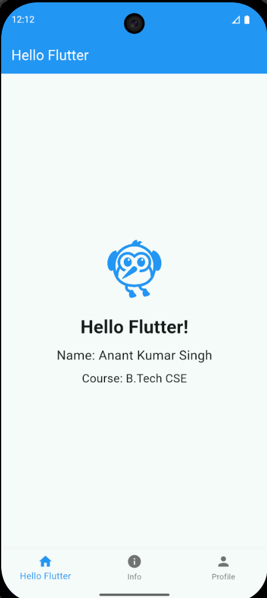
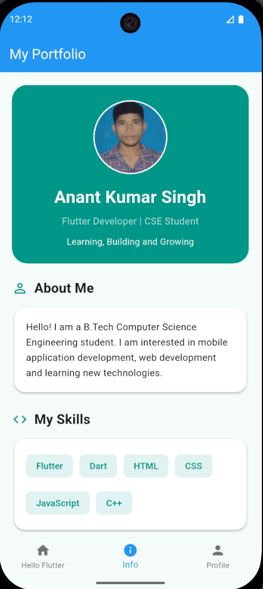
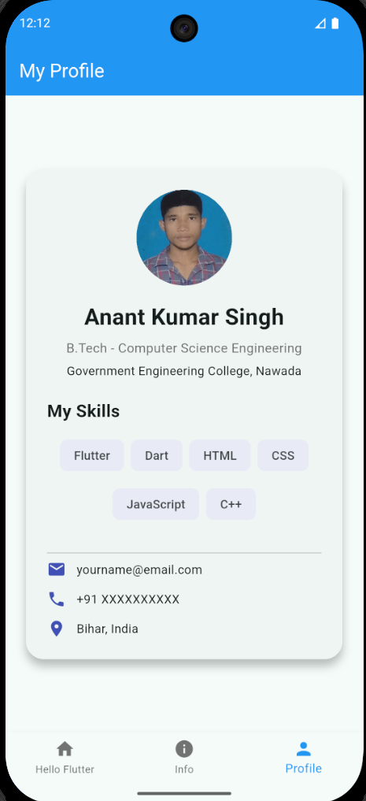

# Flutter Assignments & Mini Project (All-in-One App)

A comprehensive, clean, and responsive **Flutter Application** that combines multiple coursework assignments and a mini-project into a single interactive app using a bottom navigation setup.

## 📱 Project Breakdown & Screenshots

This app merges the following three requirements into individual modular screens:

| 1. Hello Flutter (Home)                                  | 2. Profile Card App (Info)                                             | 3. Personal Info (Profile)                                                     |
| -------------------------------------------------------- | ---------------------------------------------------------------------- | ------------------------------------------------------------------------------ |
| Displays name, degree, and welcoming course information. | Built using core layout widgets (Container, Row, Column, Image, Text). | A complete profile showcasing skills tags, responsive alignment, and contacts. |
|              |                            |                                 |

---

## ✨ Features Implemented

### 1. Hello Flutter Screen

- Simple and elegant layout displaying student identification.
- Showcases the course name and student name clearly.

### 2. Profile Card App Component

- Structured utilizing foundational structural widgets (`Container`, `Row`, `Column`).
- Incorporates assets/images alongside clean operational typography.

### 3. Personal Info App (Mini Project)

- **Static Dashboard:** Centralized screen featuring a profile photo, name, comprehensive skills array, and operational contact info.
- **Responsive Alignment:** Proper margins, color contrast, and adaptable flex layouts built to fit various screen sizes.
- **Skills Showcase:** Custom stylized chip components mapping tech proficiencies (Flutter, Dart, HTML, CSS, JavaScript, C++).

---

## 🛠️ Tech Stack & Concepts Covered

- **Framework:** Flutter (Latest Stable)
- **Language:** Dart
- **State/Navigation:** Bottom Navigation Bar switching
- **Layouts Engine:** Multi-child flex layouts (`Row`, `Column`), Box properties (`Container`, `BoxDecoration`, `Padding`), and Material tags (`Chips`, `Cards`).

---

## 🚀 Getting Started

Follow these instructions to run this project locally on your machine.

### 1. Prerequisites

Ensure you have the Flutter SDK configured on your system:

- [Flutter Installation Docs](https://flutter.dev)

### 2. Clone the Repository

```bash
git clone https://github.com/Anant-kumar227/SkillNexis_flutter_Assignment1.git
cd SkillNexis_flutter_Assignment1
```

### 3. Setup Dependencies

Fetch all configuration packages declared inside `pubspec.yaml`:

```bash
flutter pub get
```

### 4. Run the Application

Connect an emulator or testing device, then execute:

```bash
flutter run
```
